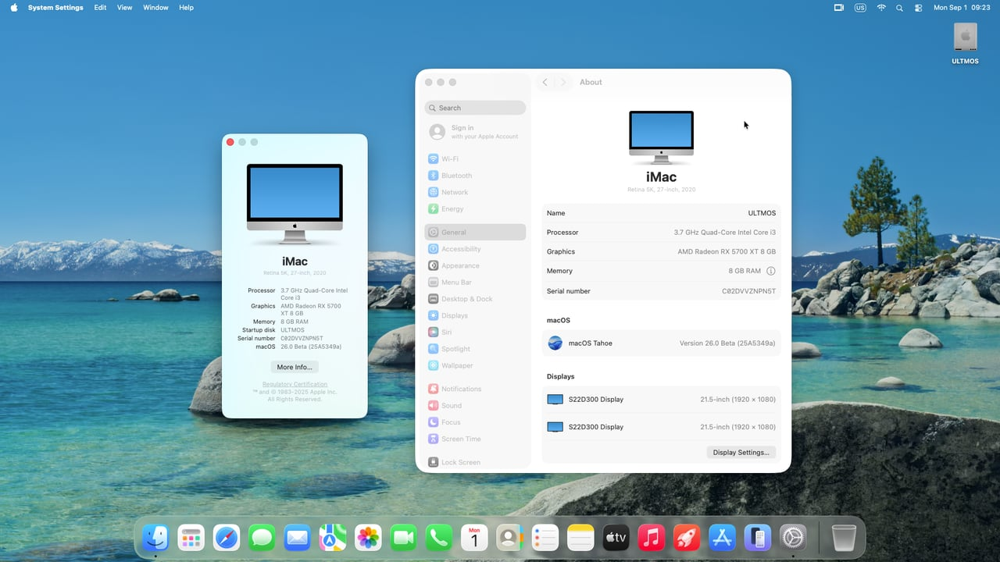

# v0.13.4

**Moderate update • 01/09/2025**

This update includes the following features / fixes / changes:

- Updated BaseSystem for macOS Tahoe developer beta 2-8
- Changed method of setting CPU topology on new boot scripts and XML conversions ([#163](https://github.com/Coopydood/ultimate-macOS-KVM/issues/163)) (@citkane)
- Changed mouse device to tablet device ([#191](https://github.com/Coopydood/ultimate-macOS-KVM/issues/191)) (@belveder79)
- Selecting an existing HDD or BaseSystem now uses a filepicker GUI dialog
- Default virtual memory is now 8GB for macOS 15 and later
- Fixed syntax errors in GPU passthrough script (#192) (@Fedeton)
- Fixed screenshots
- New screenshots on readme
- Added internal-only debug tools menu
- Added a cute rainbow sheep to the resources folder
- *Take that - Data and Privacy screen!!!1!*

<h4>Screenshots</h4>

See attached screenshots for a visualisation of the changes described.
  

 <i>macOS Tahoe developer beta 8 running on ULTMOS!</i> 

  

To see individual code changes, visit the project's commits page at <https://github.com/Coopydood/ultimate-macOS-KVM/commits/main>

> [!NOTE]
> This release has multiple authors. Attributions for contributor changes are included in relevant lines above.

> [!NOTE]
> Remember, commits by Coopydood will always be signed as **4CD28348A3DD016F** or GitHub's public key.
