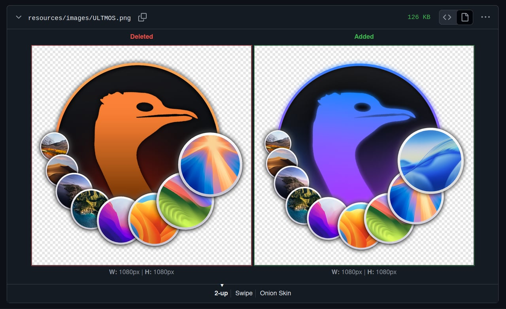

# v0.14.0

**Major update • 31/01/2026**

This update includes the following features / fixes / changes:

- Full macOS Tahoe support
- Major ULTMOS rebrand; new logo and typography
- Added macOS Tahoe support to AutoPilot
- Added support for auto-downloading macOS Tahoe in AutoPilot
- Added internal detection to system profiler
- Updated Discord rich presence module
- Updated OVMF code to latest build
- Updated ULTMOS logo on OVMF splash screen
- Fixed an issue where Discord RPC would not update when selecting macOS Big Sur in AutoPilot
- **⭐ THANK YOU FOR 1,000 STARS! 💛**
- *1, 2, skip a few, 15, 26????*

<h4>Screenshots</h4>

See attached screenshots for a visualisation of the changes described.
  

 <i>All-new ULTMOS logo for v0.14.0. (Gen3)</i> 

  

To see individual code changes, visit the project's commits page at <https://github.com/Coopydood/ultimate-macOS-KVM/commits/main>

> [!NOTE]
> Remember, commits by Coopydood will always be signed as **4CD28348A3DD016F** or GitHub's public key.
